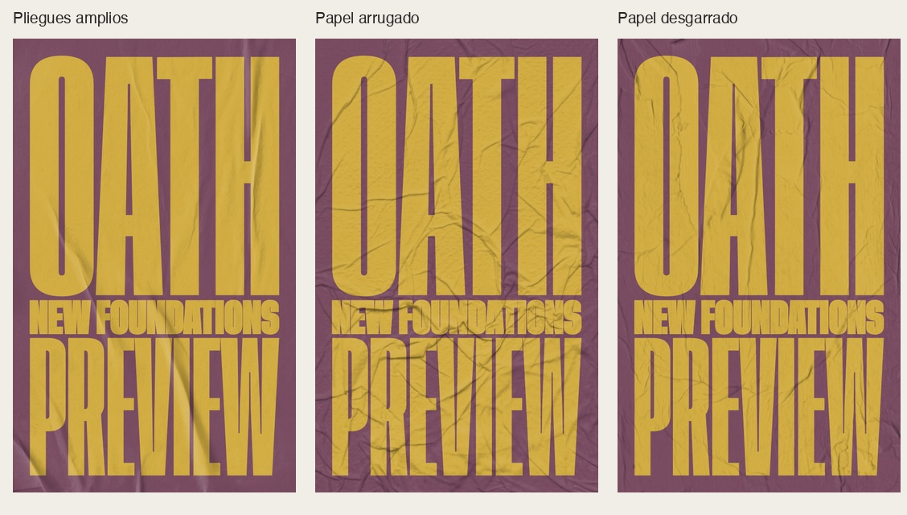
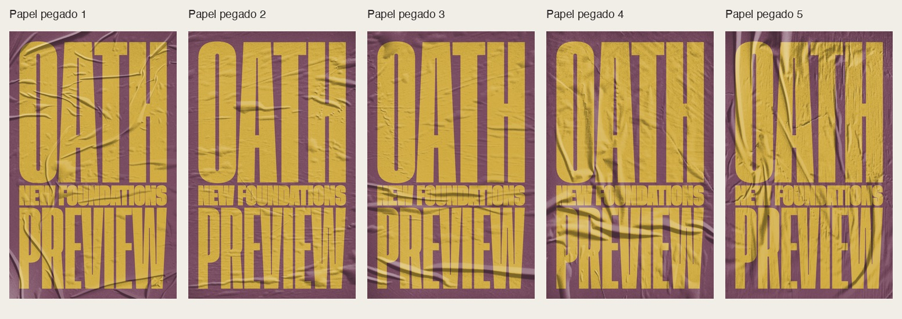

# Prueba de arrugas extraídas de fotografías

## Punto de continuidad · 14 de noviembre de 2026

Tras revisar los intentos de arrugas generadas, se decidió probar las tres fotos de alta resolución que el usuario dejó en Downloads. La tarea consiste en extraer su iluminación y superponerla al cartel como una capa de arrugas. Esta decisión sustituye la búsqueda de realismo mediante nuevas geometrías aleatorias.

El usuario ha revisado y aprobado visualmente el acabado de las tres primeras capas. Después ha aportado cinco imágenes más en Downloads/papel pegado para incorporarlas a la aplicación. El selector incluye ahora ocho capas fotográficas. No se ha creado un commit.

## Imágenes de partida

| Selector | Archivo aportado en Downloads | Resolución original | Mapa incluido |
| --- | --- | --- | --- |
| Pliegues amplios · foto | `white-crinkled-paper-texture-background.jpg` | 4672 × 7000 | 2400 × 3596 |
| Papel arrugado · foto | `white-paper-texture-background(1).jpg` | 2454 × 3436 | 2400 × 3360 |
| Papel desgarrado · foto | `white-paper-texture-background.jpg` | 4469 × 6257 | 2400 × 3360 |
| Papel pegado 1 · foto | `papel pegado/papel pegado1.jpg` | 3000 × 4500 | 2400 × 3600 |
| Papel pegado 2 · foto | `papel pegado/papel pegado2.jpg` | 3000 × 4500 | 2400 × 3600 |
| Papel pegado 3 · foto | `papel pegado/papel pegado3.jpg` | 3000 × 4500 | 2400 × 3600 |
| Papel pegado 4 · foto | `papel pegado/papel pegado4.jpg` | 3000 × 4500 | 2400 × 3600 |
| Papel pegado 5 · foto | `papel pegado/papel pegado5.jpg` | 3000 × 4500 | 2400 × 3600 |

Las fotos originales se leen sin modificarlas. El recurso generado incluye el nombre, tamaño y SHA-256 de cada original para identificarlo en futuras sesiones.

## Extracción y aplicación

`tools/extract-paper-textures.py` convierte las fotos a luminancia, reduce el ruido y retira la iluminación general mediante una referencia desenfocada. Guarda la diferencia logarítmica como un mapa de gris neutro 128 en `assets/paper/textures.js`. El script requiere Pillow y NumPy solo para regenerar los mapas:

```sh
python3 tools/extract-paper-textures.py /ruta/a/Downloads
```

El navegador convierte los valores por debajo de 128 en negro transparente y los superiores en blanco transparente. La intensidad controla la opacidad y el contraste refuerza la señal. No se reconstruyen alturas 3D, no se vectorizan las crestas ni se desplazan las letras: se reutilizan las luces y sombras fotografiadas.

La capa cubre el cartel conservando proporciones y recortando desde el centro. Gira 90° para formatos horizontales. La vista previa utiliza 700 píxeles de ancho; las exportaciones, hasta 2400. El anexo inferior queda fuera de la capa. Los mapas están incluidos como datos para que funcione abriendo el HTML directamente, sin servidor ni conexión.

Al ampliar el catálogo a ocho fotos, la decodificación se realiza al seleccionar cada capa. Se mantienen como máximo dos imágenes decodificadas en memoria; volver a una anterior vuelve a cargarla desde los datos incluidos, sin conexión.

Se conserva el motor por semilla como opción. Los borradores y JSON anteriores sin `wsource` continúan usando ese motor. Los proyectos nuevos comienzan con Pliegues amplios. Se mantienen las claves de almacenamiento y la versión 1 del JSON, añadiendo únicamente el ajuste `wsource`.

## Revisión



Comprobado en Chrome, abriendo el archivo HTML directamente:

- Tres capas distintas, con luces y sombras, resultado estable y transparencia al 0 %.
- Encuadre vertical y horizontal y concordancia entre 700 y 2400 píxeles de ancho.
- Los siete formatos del selector y coexistencia con una imagen de fondo subida.
- PNG y SVG con fuente y capa incrustadas; JSON con el selector y los ajustes.
- Capa de impresión de 2400 × 3840 píxeles incrustada en un SVG de prueba.
- Restauración tras recargar y compatibilidad con JSON y borradores anteriores.
- Alternancia con el efecto por semilla, desactivación y exclusión del anexo.
- Controles ajustados a la capa elegida, pantalla de 320 píxeles y ausencia de excepciones JavaScript.

Las capturas comparan Intensidad 65 % y Contraste 100 % sobre el mismo cartel OATH. La opción de pliegues amplios es la referencia inicial recomendada para esta prueba.

## Ampliación: cinco fotos de papel pegado



Las cinco imágenes nuevas reciben el mismo tratamiento y resolución de mapa que las anteriores. Comprobado en Chrome, sin servidor:

- Ocho mapas y ocho opciones distintas, con luces y sombras, transparencia al 0 % y encuadre horizontal.
- PNG y SVG exportados para cada una de las cinco capas nuevas.
- Guardado y apertura de JSON y restauración de Papel pegado 5 tras recargar.
- Máximo de dos imágenes decodificadas y recuperación de una capa anterior al volver a seleccionarla.
- Exclusión del anexo, selector en pantalla de 320 píxeles y ausencia de excepciones JavaScript.

La comparativa utiliza Intensidad 65 % y Contraste 100 %. Los identificadores existentes se conservan; los nuevos son `photo-glued-1` a `photo-glued-5`.
